<div align="center">

<picture>
  <source media="(prefers-color-scheme: dark)" srcset="docs/assets/banner-dark.svg">
  
</picture>

A tiny, zero-dependency, never-panicking HTML parser with CSS selectors —
for Rust, your shell, and JavaScript (via a ~38 KB gzipped WebAssembly module).

[](https://crates.io/crates/dom-tree-rs)
[](https://www.npmjs.com/package/dom-tree-wasm)
[](https://docs.rs/dom-tree-rs)
[](https://github.com/iamsaquib8/dom-tree-rs/actions/workflows/ci.yml)


[](#msrv)
[](./LICENSE)

[**▶ Try it in your browser**](https://iamsaquib8.github.io/dom-tree-rs/) ·
[Rust docs](https://docs.rs/dom-tree-rs) ·
[CLI](./cli) ·
[JavaScript](./dom-tree-wasm) ·
[Roadmap](./ROADMAP.md)



</div>

---

```rust
let dom = domtree::parse(r#"<ul id=links><li><a href="/a">One</a><li><a href="/b">Two</a></ul>"#);

for a in dom.select("#links a[href]") {
    println!("{} -> {}", a.text_content(), a.attr("href").unwrap_or_default());
}
// One -> /a
// Two -> /b        (the missing </li>s were recovered)

let md = domtree::parse("<h2>Notes</h2><p>Some <b>bold</b> text</p>").to_markdown();
assert_eq!(md, "## Notes\n\nSome **bold** text");
```

## Pick your entry point

<table>
<tr>
<th width="33%">🦀 Rust library</th>
<th width="33%">🖥️ Command line</th>
<th width="33%">🌐 JavaScript / WASM</th>
</tr>
<tr valign="top">
<td>

```toml
[dependencies]
dom-tree-rs = "0.3"
```

```rust
let dom = domtree::parse(html);
dom.select_first("h1")
   .map(|h| h.to_text());
```

</td>
<td>

```sh
cargo install domtree-cli
```

```sh
curl -sL rust-lang.org \
  | domtree -t h1
```

</td>
<td>

```sh
npm install dom-tree-wasm
```

```js
import init, { select }
  from "dom-tree-wasm";
await init();
select(html, "a[href]");
```

</td>
</tr>
</table>

Also: 🐍 **Python** — `pip install dom-tree-rs` ([docs](./python)) · 🍺 **Homebrew** —
`brew install iamsaquib8/tap/domtree` · ⚡ **WASI** — `domtree.wasm` on every
[release](https://github.com/iamsaquib8/dom-tree-rs/releases).

## Why dom-tree-rs?

- **Zero dependencies.** One crate in your `cargo tree`. A clean build takes
  **0.6 s** — `scraper` pulls in 42 crates and takes 5.3 s.¹
- **Never panics.** Any byte sequence gives you a best-effort tree. Proptested and
  fuzzed: `parse`, `select`, `to_text`, `to_markdown`. Deep nesting can't blow the
  stack.
- **Real CSS selectors.** Combinators (` `, `>`, `+`, `~`), every attribute
  operator, `:nth-child()`, `:not()`, `:is()`, `:has()`, and the scraper's
  favourite, `:contains("text")`.
- **Content out, not just a tree.** Readable text (`to_text`), CommonMark/GFM
  Markdown (`to_markdown`) for LLM prompts and RAG pipelines, JSON, and HTML.
- **Runs everywhere.** `no_std + alloc`, `#![forbid(unsafe_code)]`, a ~38 KB
  gzipped wasm module for browsers, Cloudflare Workers, Deno, Bun and Node, and a
  single static binary for your shell.
- **Fast enough.** ~250 MiB/s — within 5–15 % of [`tl`][tl] while building an owned
  tree (see [Performance](#performance)).

<sub>¹ Clean debug `cargo build` of an empty crate depending only on the parser (default
features), Apple M4 Pro, 14 cores: dom-tree-rs 0.6 s · tl 0.4 s · html5ever 2.9 s ·
scraper 5.3 s · lol_html 6.9 s. Fewer cores widens the gap.</sub>

## Cookbook

<details open>
<summary><b>Scrape links, titles, and attributes</b></summary>

```rust
let dom = domtree::parse(html);

let title = dom.select_first("title").map(|t| t.to_text());
let links: Vec<&str> = dom.select("a[href^='https://']").filter_map(|a| a.attr("href")).collect();
let price = dom.select_first(".product:has(.in-stock) .price").map(|p| p.to_text());
```
</details>

<details>
<summary><b>Turn a web page into Markdown for an LLM</b></summary>

```rust
let dom = domtree::parse(html);
let article = dom.select_first("article, main").map(|n| n.to_markdown());
```

Or from the shell, stripping the chrome first:

```sh
curl -sL https://blog.rust-lang.org | domtree -r 'nav, footer, script' --markdown body
```
</details>

<details>
<summary><b>Keep just the article, chunked for RAG</b></summary>

```rust
let dom = domtree::parse(html);
let article = dom.main_content();                   // reader mode: drops nav, ads, comments…
let chunks = match article {
    Some(node) => node.to_markdown_chunks(1500),
    None => dom.to_markdown_chunks(1500),
};
for chunk in &chunks {
    println!("[{}]\n{}", chunk.context(), chunk.markdown); // e.g. "[Guide > Install]"
}
```
</details>

<details>
<summary><b>Links, page metadata, and tables as data</b></summary>

```rust
let dom = domtree::parse(html);

for link in dom.links(Some("https://example.com/blog/")) {
    println!("{} -> {}", link.text, link.url);       // resolved, honours <base href>
}

let meta = dom.metadata();                          // title, description, OpenGraph, JSON-LD…
println!("{:?} {:?}", meta.title, meta.canonical);

if let Some(table) = dom.select_first("table#prices") {
    let rows = table.table_rows();                  // colspan/rowspan expanded
    print!("{}", domtree::to_csv(&rows));
}
```
</details>

<details>
<summary><b>Compile a selector once, reuse it, and get real errors</b></summary>

```rust
use domtree::Selector;

let sel = Selector::parse("li:nth-child(odd) > a").expect("valid selector");
for page in pages {
    let dom = domtree::parse(page);
    let count = dom.select(&sel).count();
}

let err = Selector::parse("a:hover").unwrap_err();
println!("{err}"); // unsupported pseudo-class ':hover' at byte 1
```
</details>

<details>
<summary><b>Walk the tree</b></summary>

```rust
let link = dom.select_first("a").unwrap();
let section = link.closest("section");          // nearest matching ancestor
let parent = link.parent();                     // O(1) — arena-backed
let next = link.next_element_sibling();
for node in link.ancestors() { /* … */ }
for node in dom.root().unwrap().descendants() { /* … */ }
```
</details>

<details>
<summary><b>Edit and re-serialize</b></summary>

```rust
let mut dom = domtree::parse("<p>Hi <script>track()</script><a href=/x>x</a></p>");
let scripts: Vec<_> = dom.select("script").map(|n| n.id()).collect();
for id in scripts {
    dom.remove(id);
}
assert_eq!(dom.to_html(), r#"<p>Hi <a href="/x">x</a></p>"#);

// Insert parsed HTML, wrap, rename, set attributes and text:
let a = dom.select_first("a").unwrap().id();
dom.set_attr(a, "rel", "nofollow");
dom.insert_html_after(a, " <b>new</b>");
dom.wrap(a, "em");
let p = dom.root().unwrap().id();
dom.rename(p, "div");
assert_eq!(
    dom.to_html(),
    r#"<div>Hi <em><a href="/x" rel="nofollow">x</a></em> <b>new</b></div>"#
);
```
</details>

<details>
<summary><b>Point back into the source</b></summary>

```rust
let src = "<ul>\n  <li>one\n  <li>two</ul>";
let dom = domtree::parse(src);
let li = dom.select("li").nth(1).unwrap();
let range = li.source_range().unwrap();              // byte range in `src`
assert_eq!(&src[range.clone()], "<li>two");
assert_eq!(domtree::line_col(src, range.start), (3, 3)); // 1-based line, column
```
</details>

## Command line

`domtree` is a maintained, zero-dependency, drop-in replacement for
[`htmlq`](https://github.com/mgdm/htmlq) — same flags, plus Markdown, JSON/JSON
Lines and CSV output, structured extraction, reader mode, encoding detection,
a linter, and modern selectors. [Full CLI docs →](./cli)

```sh
curl -s https://news.ycombinator.com | domtree -t '.titleline > a'           # headlines
curl -sL https://www.rust-lang.org | domtree -b https://www.rust-lang.org -a href 'nav a'
curl -sL https://blog.rust-lang.org | domtree -r 'nav, footer' --markdown body # page → Markdown
domtree -c 'img:not([alt])' < page.html                                       # a11y check
echo '<ul><li>a<li>b</ul>' | domtree -p                                       # pretty-print

# Structured extraction: one JSON object per post
curl -sL https://blog.rust-lang.org | domtree --jsonl -b https://blog.rust-lang.org/ \
  -e title=a -e url=a@href 'tr:has(a)'
# {"title":"Announcing Rust 1.99.1","url":"https://blog.rust-lang.org/2026/10/15/Rust-1.99.1/"}

# Reader mode → Markdown, tables → CSV, page metadata → JSON
curl -sL https://blog.rust-lang.org/2025/02/20/Rust-1.85.0/ | domtree --main --markdown
domtree --csv 'table#prices' < report.html
domtree --meta < page.html

# Lint HTML in CI (file:line:col, exit 1 on findings)
domtree lint public/**/*.html
```

## JavaScript & WebAssembly

The same parser — selectors, text, Markdown and all — in a ~38 KB (gzipped) wasm
module with zero JS dependencies and full TypeScript types. Works in the browser,
Cloudflare Workers, Deno, Bun, and Node (no setup needed in Node).
[Package docs →](./dom-tree-wasm) · [**Playground →**](https://iamsaquib8.github.io/dom-tree-rs/)

```js
import init, { parse, select, toMarkdown, Document } from "dom-tree-wasm";
await init(); // browsers and Workers; harmless in Node

const tree = parse("<ul><li>a<li>b</ul>");   // typed tree: { type: "document", children: [...] }
const links = select(html, "a[href]");       // [{ tag, attrs, text, html, nodeIndex }, ...]
const md = toMarkdown(html, "article");      // just the article, as Markdown

const page = new Document(html);             // parse once, query many times
const headings = page.select("h2").map((h) => h.text);
page.free();
```

## Python

Same engine, Pythonic API, abi3 wheels for Linux, macOS and Windows (Python ≥ 3.9).
The GIL is released while parsing large documents. [Package docs →](./python)

```python
import domtree

doc = domtree.parse(html)
links = [a.attr("href") for a in doc.select("a[href]")]
price = doc.select_first(".product:has(.in-stock) .price").text
markdown = doc.select_first("article").to_markdown()   # ready for an LLM prompt
```

## How it compares

| | dom-tree-rs | [tl] | [scraper] | [html5ever] | [lol_html] |
|---|:---:|:---:|:---:|:---:|:---:|
| Transitive dependencies | **0** | 0 | 42 | 19 | 41 |
| CSS selectors | **✅** | limited | ✅ | ❌ | ✅ |
| Text / Markdown output | **✅** | ❌ | ❌ | ❌ | ❌ |
| JSON output | **✅** | ❌ | ❌ | ❌ | ❌ |
| WASM + npm package | **✅** | ❌ | ❌ | ❌ | ❌ |
| CLI | **✅** | ❌ | ❌ | ❌ | ❌ |
| `no_std` | **✅** | ❌ | ❌ | ❌ | ❌ |
| Edit + re-serialize | **✅** | ❌ | ❌ | ✅ | ✅ (streaming) |
| Never panics on input | ✅ | ✅ | ✅ | ✅ | ✅ |
| WHATWG spec-compliant tree | ❌ | ❌ | ✅ | ✅ | ❌ |

**When to pick something else:** if you need byte-exact browser parsing, use
[`html5ever`][html5ever]/[`scraper`][scraper]. If raw throughput is all that matters, use [`tl`][tl]. If
you're sanitizing untrusted HTML, use [`ammonia`](https://crates.io/crates/ammonia)
— never a forgiving, non-spec parser.

[tl]: https://crates.io/crates/tl
[scraper]: https://crates.io/crates/scraper
[html5ever]: https://crates.io/crates/html5ever
[lol_html]: https://crates.io/crates/lol_html

## Performance

Parsing is fast *for an owned tree*. Synthetic article workload, Apple M-series,
single core, `--release`:

| input | dom-tree-rs | tl |
|---|---:|---:|
| ~1 KB   | ~256 MiB/s | ~308 MiB/s |
| ~50 KB  | ~250 MiB/s | ~297 MiB/s |
| ~1 MB   | ~248 MiB/s | ~257 MiB/s |

html5ever benches around ~50 MB/s in the community
[rust-html-parser-benchmark]. Run ours with `cd benchmarks && cargo bench`.

[rust-html-parser-benchmark]: https://github.com/y21/rust-html-parser-benchmark

## What it handles

Void elements, self-closing tags, comments, doctypes, CDATA, raw text
(`<script>`/`<style>`), escapable raw text (`<title>`/`<textarea>`), boolean and
unquoted attributes, hyphenated/namespaced/custom tags, named + numeric entities
(with browser-style Windows-1252 remapping), and implicit closing for the everyday
cases (`<li>`, `<p>`, table cells/rows, `<dt>`/`<dd>`, `<option>`). Everything it
recovers from is recorded in
[`Dom::errors`](https://docs.rs/dom-tree-rs/latest/domtree/struct.Dom.html#method.errors).

**Deliberately not done:** full WHATWG tree construction (adoption agency, automatic
`<html>`/`<head>`/`<body>`, foster parenting). See the [non-goals](./ROADMAP.md#non-goals).

## Cargo features

| feature | default | what it adds |
|---|:---:|---|
| `json` | ✅ | `to_json()` — zero-dependency JSON |
| `query` | ✅ | CSS selectors: `select`, `select_first`, `Selector`, `closest`, `matches` |
| `markdown` | ✅ | `to_markdown()` and `to_markdown_chunks()` — zero-dependency HTML → Markdown |
| `entities-full` | | all 2,125 WHATWG named character references (default: the 178 most common) |
| `serde` | | `serde::Serialize` for the tree (same JSON shape; adds `serde`) |
| `std` | | `std::error::Error` impls; the crate is `no_std + alloc` otherwise |

## MSRV

Rust **1.85** (edition 2024), enforced in CI.

## Quality

Property-tested ("never panics" + tree invariants), snapshot-tested against a
corpus of messy HTML, fuzzed with `cargo-fuzz`, and CI-checked for fmt, clippy,
`no_std`, MSRV, zero dependencies and a wasm size budget.

## Contributing

Issues and PRs are welcome! Start with [CONTRIBUTING.md](./CONTRIBUTING.md), the
[architecture guide](./docs/ARCHITECTURE.md), and the [roadmap](./ROADMAP.md) —
issues labelled **good first issue** are a friendly way in. Please follow the
[code of conduct](./CODE_OF_CONDUCT.md), and report security problems privately
as described in [SECURITY.md](./SECURITY.md).

If dom-tree-rs saved you some time, a ⭐ helps other people find it.

## License

[MIT](./LICENSE)
