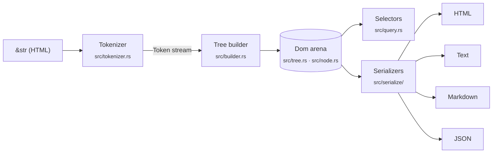

# Architecture

A map of the codebase for contributors. The whole library is about 5,000 lines
of dependency-free Rust; you can read all of it in an afternoon.

## The pipeline



1. **Tokenizer** (`src/tokenizer.rs`, `src/token.rs`) — a pull-based,
   byte-driven state machine that yields borrowed `Token`s (start/end tags,
   text, comments, doctypes). It also handles raw-text elements
   (`<script>`, `<style>`, `<title>`, `<textarea>`). Public as
   `domtree::tokenize` for streaming use.
2. **Tree builder** (`src/builder.rs`) — consumes tokens with an
   *open-elements stack* and applies the recovery rules: implicit closing
   (`src/tags.rs`), void elements, mis-nested and stray end tags. Every recovery
   is recorded as a `ParseError` (`src/error.rs`) instead of failing. Entities are
   decoded here (`src/entities.rs`).
3. **The `Dom`** (`src/tree.rs`, `src/node.rs`) — an arena (`Vec<Node>`) of
   nodes linked by `parent` / `first_child` / `last_child` / `next_sibling` /
   `prev_sibling` ids, so every traversal step is O(1). All strings (tag names,
   attributes, text) live in **one** `String` buffer and nodes refer to them by
   `Span` (byte range); this replaces thousands of small allocations with
   appends to a single buffer and is the main reason parsing is fast.
   `NodeRef<'a>` is the public, `Copy` read handle. Top-level nodes are linked as
   siblings of each other (a linked list from `first_root` to `last_root`).
   `NodeId` is a non-zero `u32`, so `Option<NodeId>` is 4 bytes and a `Node` is
   64 bytes. Each parsed node also records its **source range** (two `u32`s;
   `NodeRef::source_range`, `domtree::line_col` in `src/source.rs`).
4. **Editing** (`src/edit.rs`) — `remove`, attribute edits, `set_text`,
   `rename`, `create_*`, `append_child` / `insert_before`, `wrap` / `unwrap`,
   and parsed-fragment insertion. Removed and created nodes stay in the arena
   flagged `detached` (always uniformly per subtree) and every iterator skips
   them. While no node has been inserted mid-document, arena order *is* document
   order and `Dom::nodes()` is a plain scan; the first insertion or move sets a
   `reordered` flag and `nodes()` switches to an allocation-free walk of the
   links. Moves refuse to create cycles.
5. **Selectors** (`src/query.rs`, `query` feature) — a hand-written CSS parser
   producing a compiled `Selector`, and a right-to-left matcher. Descendant and
   `~` chains take the nearest match per segment, so matching never backtracks
   exponentially and never recurses on document depth.
6. **Serializers** (`src/serialize/`) — `html.rs` (re-serialization), `text.rs`
   (readable text), `markdown.rs` (CommonMark + GFM), `json.rs` (zero-dependency
   JSON), `serde_impl.rs` (optional `serde`, byte-identical to `json.rs`). The
   shared `walk` in `src/serialize/mod.rs` visits a subtree using the tree's
   links — no recursion.

Around the core: `cli/` (the `domtree` binary, a workspace member),
`dom-tree-wasm/` (wasm-bindgen bindings and npm package), `playground/` (the
GitHub Pages site), `benchmarks/` and `fuzz/` (separate crates with their own
dependencies, excluded from the workspace).

## Invariants — please keep these

| invariant | how it's enforced |
|---|---|
| **Never panic on any input** — HTML, selector strings, anything | `#![deny(clippy::unwrap_used, expect_used, panic)]` in lib code; no indexing on input-derived data (use `.get(..)`); proptest suites (`tests/properties.rs`, `tests/query_properties.rs`, `tests/output_properties.rs`); `cargo-fuzz` targets for `parse`, `tokenize`, `select`, `markdown` |
| **Bounded stack** — no recursion proportional to document depth | explicit stacks or link-following walks; tests with 100,000-deep nesting |
| **No accidental super-linear blow-ups** | nesting caps (selector arguments: 32 levels; Markdown containers: 32), padding caps for ragged tables, deep/wide stress tests |
| **Zero runtime dependencies by default** | CI `cargo tree` gate; new deps must be optional features |
| **`no_std + alloc`** | `#![no_std]`; CI builds for `thumbv7em-none-eabi` |
| **No `unsafe`** | `#![forbid(unsafe_code)]` |
| **MSRV 1.85** | CI `msrv` job |

## Where to make common changes

- **A parsing/recovery fix** → `src/builder.rs` or `src/tags.rs`. Add a fixture to
  `tests/corpus/` (snapshot via `insta`) and a focused test in `tests/parsing.rs`.
- **A new entity or decoding rule** → `src/entities.rs`, tests in `tests/entities.rs`.
- **A selector feature** → parse in `src/query.rs` (`parse_*` functions), match in
  the matcher below it; add cases to `tests/query.rs`. If it changes matching
  logic, extend the differential checks in `tests/query_properties.rs`.
- **Text/Markdown output** → `src/serialize/text.rs` / `markdown.rs`; which
  elements are blocks, inline, or hidden lives in `src/tags.rs`. Tests in
  `tests/text_output.rs` / `tests/markdown_output.rs`, page snapshots from
  `tests/pages/`.
- **A CLI flag** → `cli/src/args.rs` (parsing + `--help` text) and
  `cli/src/main.rs`; end-to-end tests in `cli/tests/cli.rs`.
- **The JS API** → `dom-tree-wasm/src/lib.rs`; tests in `dom-tree-wasm/tests/`.

## Testing at a glance

```sh
cargo test --workspace --all-features   # unit, snapshots, proptests, doctests, CLI e2e
cargo clippy --workspace --all-features --all-targets -- -D warnings
cargo +nightly fuzz run select          # or parse / tokenize / markdown
```

After an intentional output change, review and accept snapshots with
`INSTA_UPDATE=always cargo test` and read the `.snap` diffs before committing.
