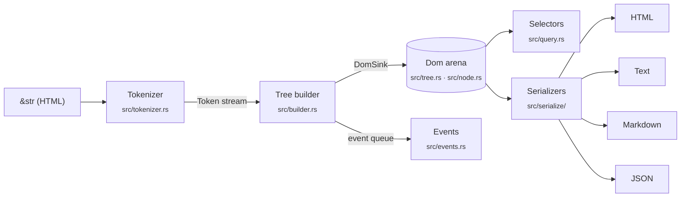

# Architecture

A map of the codebase for contributors. The whole library is about 5,000 lines
of dependency-free Rust; you can read all of it in an afternoon.

## The pipeline



1. **Tokenizer** (`src/tokenizer.rs`, `src/token.rs`) — a pull-based,
   byte-driven state machine that yields borrowed `Token`s (start/end tags,
   text, comments, doctypes). It also handles raw-text elements
   (`<script>`, `<style>`, `<title>`, `<textarea>`). Public as
   `domtree::tokenize` for streaming use. Internally the tree builder pulls
   tokens with `next_token`, which leaves a start tag's attributes in a buffer
   reused for every tag, so parsing allocates nothing per tag. Every search for
   the next `<`, `&`, quote, `>` or `-->` goes through `src/scan.rs`: a safe
   16-bytes-per-step SWAR search by default, `memchr` with the `simd` feature
   (both unit-tested against each other, so the two builds tokenize
   identically).
2. **Tree builder** (`src/builder.rs`) — consumes tokens with an
   *open-elements stack* and applies the recovery rules: implicit closing
   (`src/tags.rs`), void elements, mis-nested and stray end tags. Every recovery
   is recorded as a `ParseError` (`src/error.rs`) instead of failing. The
   builder does not build anything itself: it is generic over a `Sink` it
   reports elements, text, comments and ends to. `DomSink` fills the `Dom`
   arena (lower-casing names and decoding entities — `src/entities.rs` —
   straight into its string buffer); the event queue in `src/events.rs`
   becomes `domtree::events`. So the tree and the event stream apply the same
   recovery by construction, and the `Dom` path monomorphizes to the same code
   as a hand-written builder.
3. **The `Dom`** (`src/tree.rs`, `src/node.rs`) — an arena (`Vec<Node>`) of
   nodes linked by `parent` / `first_child` / `last_child` / `next_sibling` /
   `prev_sibling` ids, so every traversal step is O(1). All strings (tag names,
   attributes, text) live in **one** `String` buffer and nodes refer to them by
   `Span` (byte range); this replaces thousands of small allocations with
   appends to a single buffer and is the main reason parsing is fast.
   `NodeRef<'a>` is the public, `Copy` read handle. Top-level nodes are linked as
   siblings of each other (a linked list from `first_root` to `last_root`).
   Attributes live in a second arena, one `Vec<(Span, Span)>` for the whole
   document; an element holds a `(start, len)` run of it (`AttrRange`), laid
   out in document order by the parser. `NodeId` is a non-zero `u32`, so
   `Option<NodeId>` is 4 bytes and a `Node` is 52 bytes. Each parsed node also
   records its **source range** (two `u32`s; `NodeRef::source_range`,
   `domtree::line_col` in `src/source.rs`). The arenas are reserved up front
   from the input length (sized for dense markup); the node and attribute
   arenas are shrunk after parsing if more than half is unused (prose).
4. **Editing** (`src/edit.rs`) — `remove`, attribute edits, `set_text`,
   `rename`, `create_*`, `append_child` / `insert_before`, `wrap` / `unwrap`,
   and parsed-fragment insertion. Removed and created nodes stay in the arena
   flagged `detached` (always uniformly per subtree) and every iterator skips
   them. While no node has been inserted mid-document, arena order *is* document
   order and `Dom::nodes()` is a plain scan; the first insertion or move sets a
   `reordered` flag and `nodes()` switches to an allocation-free walk of the
   links. Moves refuse to create cycles. Adding an attribute appends to the
   element's run when it ends the attribute arena, and otherwise moves the run
   to the end first; the slots left behind are counted, and the arena is
   compacted once they outnumber the live slots plus the nodes, so any edit
   sequence stays linear. Fragment insertion parses the fragment on its own
   and appends its arenas wholesale, shifting ids, spans and runs.
5. **Selectors** (`src/query.rs`, `query` feature) — a hand-written CSS parser
   producing a compiled `Selector`, and a right-to-left matcher. Descendant and
   `~` chains take the nearest match per segment, so matching never backtracks
   exponentially and never recurses on document depth.
6. **Serializers** (`src/serialize/`) — `html.rs` (re-serialization), `text.rs`
   (readable text), `markdown.rs` (CommonMark + GFM), `json.rs` (zero-dependency
   JSON), `serde_impl.rs` (optional `serde`, byte-identical to `json.rs`). The
   shared `walk` in `src/serialize/mod.rs` visits a subtree using the tree's
   links — no recursion.

Around the core: `cli/` (the `domtree` binary, a workspace member),
`dom-tree-wasm/` (wasm-bindgen bindings and npm package), `playground/` (the
GitHub Pages site), `benchmarks/` and `fuzz/` (separate crates with their own
dependencies, excluded from the workspace).

## Invariants — please keep these

| invariant | how it's enforced |
|---|---|
| **Never panic on any input** — HTML, selector strings, anything | `#![deny(clippy::unwrap_used, expect_used, panic)]` in lib code; no indexing on input-derived data (use `.get(..)`); proptest suites (`tests/properties.rs`, `tests/query_properties.rs`, `tests/output_properties.rs`, `tests/events.rs`); `cargo-fuzz` targets for `parse`, `tokenize`, `select`, `markdown` |
| **The tree and the event stream agree** | one recovery state machine behind both (`Sink`); `tests/events.rs` replays events into a tree and compares it with `parse` node for node on arbitrary input |
| **Browser-like on the subset we claim** | `fuzz/fuzz_targets/differential.rs` compares our tree with html5ever's on generated markup from that subset (documented at the top of the file) |
| **Bounded stack** — no recursion proportional to document depth | explicit stacks or link-following walks; tests with 100,000-deep nesting |
| **No accidental super-linear blow-ups** | nesting caps (selector arguments: 32 levels; Markdown containers: 32), padding caps for ragged tables, deep/wide stress tests |
| **Zero runtime dependencies by default** | CI `cargo tree` gate; new deps must be optional features |
| **`no_std + alloc`** | `#![no_std]`; CI builds for `thumbv7em-none-eabi` |
| **No `unsafe`** | `#![forbid(unsafe_code)]` |
| **MSRV 1.85** | CI `msrv` job |

## Where to make common changes

- **A parsing/recovery fix** → `src/builder.rs` or `src/tags.rs` (the event
  stream follows automatically). Add a fixture to `tests/corpus/` (snapshot via
  `insta`) and a focused test in `tests/parsing.rs`. If it widens what we
  handle like a browser, widen the generator in `fuzz/fuzz_targets/differential.rs`.
- **A performance change** → measure with `cd benchmarks && cargo bench` (and
  `cargo run --release --example memory`) before and after; results and
  machine notes go in `benchmarks/README.md`. Keep an eye on the wasm size
  budget.
- **A new entity or decoding rule** → `src/entities.rs`, tests in `tests/entities.rs`.
- **A selector feature** → parse in `src/query.rs` (`parse_*` functions), match in
  the matcher below it; add cases to `tests/query.rs`. If it changes matching
  logic, extend the differential checks in `tests/query_properties.rs`.
- **Text/Markdown output** → `src/serialize/text.rs` / `markdown.rs`; which
  elements are blocks, inline, or hidden lives in `src/tags.rs`. Tests in
  `tests/text_output.rs` / `tests/markdown_output.rs`, page snapshots from
  `tests/pages/`.
- **A CLI flag** → `cli/src/args.rs` (parsing + `--help` text) and
  `cli/src/main.rs`; end-to-end tests in `cli/tests/cli.rs`.
- **The JS API** → `dom-tree-wasm/src/lib.rs`; tests in `dom-tree-wasm/tests/`.

## Testing at a glance

```sh
cargo test --workspace --all-features   # unit, snapshots, proptests, doctests, CLI e2e
cargo clippy --workspace --all-features --all-targets -- -D warnings
cargo +nightly fuzz run select          # or parse / tokenize / markdown / differential
cargo test --features simd              # the memchr scanning path
```

After an intentional output change, review and accept snapshots with
`INSTA_UPDATE=always cargo test` and read the `.snap` diffs before committing.

## Considered: borrowed-tree mode

*Roadmap 0.5: "an opt-in `Dom<'a>` that borrows from the source — ship only if
profiling shows a real win". Evaluated October 2026; **not implemented**.*

The question is how much of `parse` is copying strings into the arena — the
only thing borrowing would save. Two prototypes (in a scratch copy, not in the
tree), timed against the current parser in one binary, alternating, min of
31 runs each (Apple M4 Pro; inputs from `benchmarks/`):

- **no-copy** — the upper bound for a borrowed tree: attribute names and
  values, text, comments and doctypes that need no decoding or lower-casing
  are not copied at all (their spans are left dangling; timing only). Tag
  names are still interned, since the builder reads them back.
- **owned-source** — copy the whole input into the arena once, up front, and
  point spans for verbatim strings into that copy (only decoded or
  lower-cased strings are appended). Same API, correct output.

| input | no-copy | owned-source |
|---|---:|---:|
| small (0.5 KiB) | −9…−10% | −8…−11% |
| medium (21 KiB) | −10…−12% | −13…−16% |
| large (420 KiB) | −12…−14% | −15…−18% |
| table-heavy (712 KiB) | −14…−15% | −17…−20% |
| text-heavy (547 KiB) | +5% | +23…+25% |

So per-string copying is about 10–15% of parse time on dense markup (a bit
more if tag names were borrowed too), and nothing to gain on prose: every
paragraph there contains a reference (`&mdash;`, `&nbsp;`, curly quotes…),
must be decoded, and so is copied anyway — the prototypes only add a second
scan (no-copy) or a second copy (owned-source) on top.

**Decision.** A borrowed tree fails both bars. The win is at most ~15%, on
markup only; and `Dom<'a>` would put a lifetime on the central public type —
a breaking change for every user — or need a second `BorrowedDom<'a>` with a
duplicated API. The owned-source variant keeps the API but trades 15–20% on
markup for ~25% on prose (and doubles the retained string arena there), which
is the wrong trade for the text-and-Markdown users this crate serves. The
cheaper half of the idea already shipped: names are lower-cased and entities
decoded straight into the arena, with no temporary strings, and the per-tag
allocations are gone (see `benchmarks/README.md`).
